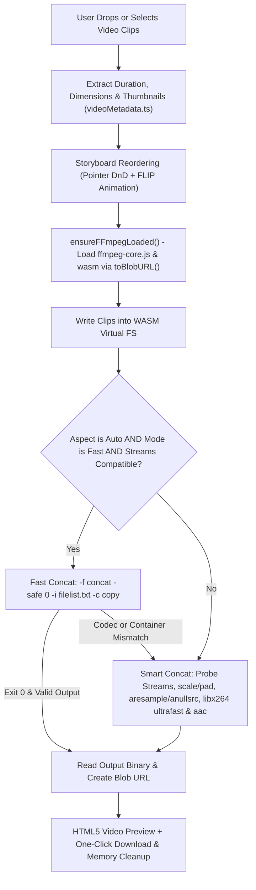

<div align="center">
  <a href="https://mergevideos.github.io/">
    
  </a>

  <h1>MergeVideos</h1>

  <p>
    <strong>100% Client-Side Online Video Merger — Combine MP4, MOV &amp; WebM Clips in Browser RAM with Zero Cloud Uploads &amp; No Watermarks.</strong>
  </p>

  <p>
    <a href="https://mergevideos.github.io/">Live App</a>
    &nbsp;&middot;&nbsp;
    <a href="https://github.com/mergevideos/mergevideos.github.io/issues">Report Bug</a>
    &nbsp;&middot;&nbsp;
    <a href="https://github.com/mergevideos/mergevideos.github.io/issues">Request Feature</a>
    &nbsp;&middot;&nbsp;
    <a href="https://kisharadilshan.gumroad.com/coffee">Support the Developer</a>
  </p>

  <p>
    <a href="https://mergevideos.github.io/"></a>
    <a href="https://astro.build/"></a>
    <a href="https://react.dev/"></a>
    <a href="https://tailwindcss.com/"></a>
    <a href="https://ffmpegwasm.netlify.app/"></a>
    <a href="./LICENSE"></a>
  </p>
</div>

---

## Table of Contents

- [Overview](#overview)
- [Key Capabilities](#key-capabilities)
- [Architecture & Merge Pipeline](#architecture--merge-pipeline)
- [Supported Formats & Output Presets](#supported-formats--output-presets)
- [Internationalization (8 Languages)](#internationalization-8-languages)
- [Tech Stack & SEO Architecture](#tech-stack--seo-architecture)
- [Design System & Color Palette](#design-system--color-palette)
- [Project Structure](#project-structure)
- [Local Development & CI/CD](#local-development--cicd)
- [Support the Developer](#support-the-developer)
- [License](#license)

---

## Overview

**MergeVideos** is an open-source, privacy-first web application built with **Astro** (`output: 'static'`) and powered by **FFmpeg.wasm** (`@ffmpeg/ffmpeg` + `@ffmpeg/core`).

Instead of uploading multi-hundred-megabyte video files to remote processing servers, all demuxing, filtering, concatenation, and encoding run **locally inside the user's browser memory**:

- **Zero Server Uploads:** Video bytes never leave the device (`fetchFile` reads directly into the WebAssembly virtual filesystem).
- **No Watermarks or Limits:** Free static web tool with no sign-up walls, queues, or branded overlays.
- **Single-Threaded WASM Compatibility:** Uses `@ffmpeg/core` (`0.12.x`) without `SharedArrayBuffer` / COOP-COEP header requirements, allowing static hosting on **GitHub Pages** and full browser support across iOS Safari, Android Chrome, and desktop browsers.
- **Offline-Ready PWA:** Service Worker (`public/sw.js`) precaches HTML routes, static bundles, icons, and FFmpeg WebAssembly binaries so installed users can merge clips completely offline.

---

## Key Capabilities

### Client-Side Video Engine
- **Dual-Mode Processing (`src/lib/ffmpegEngine.ts`):**
  - **Fast Stream Copy (`fast`):** Uses FFmpeg concat demuxer (`-f concat -safe 0 -i filelist.txt -c copy` or `-c:v copy -an`) for ~1-second lossless stitching when clips share compatible containers and resolutions.
  - **Smart Normalized Concat (`smart`):** Probes every input stream (`probeInputFile`), normalizes mixed resolutions/frame rates/color formats (`scale`, `pad`, `setsar=1`, `fps=30`, `format=yuv420p`), aligns stereo audio at `44.1 kHz` (`aresample=44100`), generates silent tracks (`anullsrc`) when mixing audio-enabled and silent clips, and encodes H.264/AAC MP4 with `+faststart` metadata.
  - **Automatic Fallback:** If Fast Stream Copy detects mismatched dimensions/containers (`hasIncompatibleStreamsForFastCopy`) or exits non-zero, it seamlessly falls back to Smart Normalized Concat without user intervention.
- **Audio & Cancellation Control:** Toggle **Keep Audio** or **Mute Audio** before merging, and cancel active merges anytime via `AbortController` (`terminateFFmpeg()`).

### Interactive Storyboard & Responsive UX
- **First-Fold `100dvh` Workspace (`src/components/VideoMerger.tsx`):** Dropzone, storyboard timeline, progress stage feedback, and HTML5 output player fit cleanly above the fold.
- **Visual Clip Management:** Extracts video dimensions, duration (`formatDuration`), and frame thumbnails (`src/lib/videoMetadata.ts`), with `#1`, `#2`, `#3` order badges, pointer drag-and-drop reordering, accessible move left/right buttons, and 60fps FLIP layout transitions.
- **Responsive Navigation (`src/components/Header.astro`):**
  - **Desktop (`>= 1024px`):** Full inline navigation bar with 8-language dropdown, Light/Dark theme switch, GitHub link, **Add to Home Screen**, and Support CTA.
  - **Mobile & Tablet (`< 1024px`):** Compact header featuring brand logo + single `48×48px` toggle icon opening a full touch-friendly drawer with synchronized theme state and 8-language grid.
- **Light & Dark Themes:** Light mode default (`#F8FFFD`) paired with zero-FOUC `localStorage` persistence (`mv-theme`) for Deep Night dark mode (`#0D1B18`).

---

## Architecture & Merge Pipeline



---

## Supported Formats & Output Presets

### Input Containers & Codecs
Accepted via MIME type `video/*` or extensions handled by `isSupportedVideoFile()`:

`MP4` &middot; `MOV` (iPhone/macOS) &middot; `WebM` &middot; `MKV` &middot; `AVI` &middot; `M4V` &middot; `3GP` &middot; `OGV` &middot; `MTS` &middot; `M2TS` &middot; `TS` &middot; `FLV`

### Output Resolution & Aspect Presets

| Preset | Output Resolution | Encoding Behavior | Ideal Use Case |
| :--- | :--- | :--- | :--- |
| **Auto / Original** | Source dimensions (capped at `1920px` max side in Smart mode) | Fast Stream Copy when compatible; otherwise normalized MP4 | Same-device recordings & fastest lossless concat |
| **16:9 Widescreen** | `1920 × 1080` (`yuv420p`, `30 fps`, letterboxed) | Smart Normalized Concat (`libx264` + `aac`) | YouTube, desktop presentations, tutorials |
| **9:16 Vertical** | `1080 × 1920` (`yuv420p`, `30 fps`, pillarboxed/letterboxed) | Smart Normalized Concat (`libx264` + `aac`) | TikTok, Instagram Reels, YouTube Shorts, iPhone vertical clips |
| **1:1 Square** | `1080 × 1080` (`yuv420p`, `30 fps`, padded) | Smart Normalized Concat (`libx264` + `aac`) | Social feeds & cross-platform embeds |

---

## Internationalization (8 Languages)

All UI copy, SEO metadata, Open Graph locales, structured data, and navigation labels are statically pre-rendered across 8 localized routes (with `prefixDefaultLocale: false` for English):

| Language | Route | `html[lang]` | `og:locale` |
| :--- | :--- | :--- | :--- |
| English | [`/`](https://mergevideos.github.io/) | `en` | `en_US` |
| Español | [`/es/`](https://mergevideos.github.io/es/) | `es` | `es_ES` |
| Português | [`/pt/`](https://mergevideos.github.io/pt/) | `pt` | `pt_BR` |
| Deutsch | [`/de/`](https://mergevideos.github.io/de/) | `de` | `de_DE` |
| Français | [`/fr/`](https://mergevideos.github.io/fr/) | `fr` | `fr_FR` |
| 日本語 | [`/ja/`](https://mergevideos.github.io/ja/) | `ja` | `ja_JP` |
| 中文 | [`/zh/`](https://mergevideos.github.io/zh/) | `zh` | `zh_CN` |
| Русский | [`/ru/`](https://mergevideos.github.io/ru/) | `ru` | `ru_RU` |

---

## Tech Stack & SEO Architecture

| Category | Implementation | Details |
| :--- | :--- | :--- |
| **Framework** | `astro` `^7.4.11` (`output: 'static'`) + `@astrojs/react` `^7.1.8` | Static HTML shell with interactive React `VideoMerger` island |
| **UI & Styling** | `react` `^19.3.1`, `tailwindcss` `^4.3.5`, `@tailwindcss/vite` | Custom CSS design tokens, `.mv-hero-viewport`, light/dark theme variables |
| **Type Safety** | `typescript` `^6.0.3` + `@astrojs/check` | Strict component & i18n dictionary validation (`npm run check`) |
| **WASM Engine** | `@ffmpeg/ffmpeg` `^0.12.15`, `@ffmpeg/util` `^0.12.2`, `@ffmpeg/core` `^0.12.10` | Copied into `public/ffmpeg/` automatically via `scripts/copy-ffmpeg-core.mjs` |
| **PWA & Offline** | [`public/manifest.webmanifest`](./public/manifest.webmanifest) + [`public/sw.js`](./public/sw.js) | Cache-first static/WASM assets + stale-while-revalidate HTML (`mergevideos-offline-v2`) |
| **Sitemaps & Robots** | [`src/pages/sitemap.xml.ts`](./src/pages/sitemap.xml.ts), `@astrojs/sitemap`, [`public/robots.txt`](./public/robots.txt) | Dual `sitemap.xml` (flat W3C `<urlset>` with `xhtml:link`) and `sitemap-index.xml` |
| **Structured Data** | [`src/components/JsonLdSchema.astro`](./src/components/JsonLdSchema.astro) | Strictly verified `@graph` (`WebApplication`, `HowTo`, `FAQPage`, `BreadcrumbList`) with zero synthetic ratings |
| **Analytics** | [`src/layouts/BaseLayout.astro`](./src/layouts/BaseLayout.astro) | Async Google Tag Manager (`GTM-NDP5XC2F`) & Google Analytics 4 (`G-JSCQLBDWHS`) |

---

## Design System & Color Palette

| Token | Hex | Light Mode Role | Dark Mode Role |
| :--- | :--- | :--- | :--- |
| **Vibrant Emerald Teal** | `#00AF91` | Workspace borders, hover accents, secondary text | Primary action buttons, borders, active highlights |
| **Deep Forest Green** | `#007965` | Primary headings, primary buttons, PWA `theme_color` | Highlight badges |
| **Energetic Tangerine** | `#F58634` | Active drag-drop border, Support CTA, progress accent | Active drag-drop border, Support CTA, progress accent |
| **Warm Sunshine Gold** | `#FFCC29` | Privacy pill badge (`#FFCC29`) | Secondary headings & hover glow |
| **Canvas Light / Dark** | `#F8FFFD` / `#0D1B18` | Primary page canvas (`#F8FFFD`) & white surfaces (`#FFFFFF`) | Deep Night canvas (`#0D1B18`), cards (`#132A25`), workspace (`#16302A`) |

---

## Project Structure

```text
mergevideos.github.io/
├── .github/workflows/
│   └── deploy.yml              # GitHub Actions (Node 22 -> Astro build -> GitHub Pages)
├── public/
│   ├── .nojekyll               # Disables Jekyll processing on GitHub Pages
│   ├── favicon.svg             # Vector brand mark
│   ├── og-image.png            # 1200x630 social share card
│   ├── manifest.webmanifest    # Standalone PWA manifest
│   ├── robots.txt              # Allows indexing + declares sitemap.xml & sitemap-index.xml
│   ├── sw.js                   # Offline-first Service Worker (precaches routes + FFmpeg WASM)
│   ├── icons/                  # 192x192 & 512x512 maskable/any PNG icons
│   └── ffmpeg/                 # Generated predev/prebuild (@ffmpeg/core JS + WASM)
├── scripts/
│   └── copy-ffmpeg-core.mjs    # Copies @ffmpeg/core/dist/esm assets into public/ffmpeg/
├── src/
│   ├── components/
│   │   ├── BelowFoldSections.astro  # SEO guides, comparison table & FAQ accordion
│   │   ├── Header.astro             # Desktop navbar (>=1024px) & mobile/tablet toggle drawer
│   │   ├── JsonLdSchema.astro       # Schema.org JSON-LD graph
│   │   ├── MergePageContent.astro   # Shared localized page assembly
│   │   └── VideoMerger.tsx          # Interactive React merger workspace
│   ├── i18n/
│   │   ├── ui.ts               # Strongly typed 8-language translation dictionary
│   │   └── utils.ts            # Route resolution & hreflang helpers
│   ├── layouts/
│   │   └── BaseLayout.astro    # HTML head, OG/Twitter tags, GTM/GA4, theme init & SW registration
│   ├── lib/
│   │   ├── ffmpegEngine.ts     # Dual-mode Fast Copy & Smart Normalized Concat engine
│   │   └── videoMetadata.ts    # Client-side thumbnail, duration & dimension extraction
│   ├── pages/
│   │   ├── index.astro         # Default English route (/)
│   │   ├── [locale]/index.astro# Localized static routes (/es/, /pt/, /de/, /fr/, /ja/, /zh/, /ru/)
│   │   └── sitemap.xml.ts      # Flat W3C XML sitemap with xhtml:link alternates
│   └── styles/
│       └── global.css          # Tailwind CSS v4 entry, palette tokens & animations
├── astro.config.mjs            # Static output, site URL, 8-locale i18n & Vite WASM config
├── package.json
├── tsconfig.json
├── LICENSE
└── README.md
```

---

## Local Development & CI/CD

### Prerequisites
- **Node.js 22+** (matches `.github/workflows/deploy.yml`) and **npm**.

### Setup & Commands

```bash
# 1. Clone the repository
git clone https://github.com/mergevideos/mergevideos.github.io.git
cd mergevideos.github.io

# 2. Install dependencies
npm install

# 3. Start local dev server (predev copies @ffmpeg/core into public/ffmpeg/)
npm run dev
```

| Script | Command | Purpose |
| :--- | :--- | :--- |
| `npm run dev` | `predev` + `astro dev` | Copies FFmpeg WASM core assets and starts hot-reload dev server |
| `npm run check` | `astro check` | Runs Astro & TypeScript diagnostics across `.astro`, `.ts`, and `.tsx` files |
| `npm run build` | `prebuild` + `astro build` | Copies FFmpeg WASM core and generates static output in `dist/` |
| `npm run preview` | `astro preview` | Serves the production `dist/` directory locally |
| `npm run copy:ffmpeg` | `node scripts/copy-ffmpeg-core.mjs` | Manually refreshes `public/ffmpeg/ffmpeg-core.{js,wasm}` |

### Automated GitHub Pages Deployment

Every push to `main` (or manual `workflow_dispatch`) triggers [`.github/workflows/deploy.yml`](./.github/workflows/deploy.yml):

1. Checks out the repository and ensures `public/.nojekyll` exists so `_astro/` and `ffmpeg/` paths are served untouched.
2. Runs `withastro/action@v3` on **Node 22** (`npm install` -> `prebuild` -> `astro build` -> uploads `dist/`).
3. Publishes the artifact to the `github-pages` environment via `actions/deploy-pages@v4`.

---

## Support the Developer

MergeVideos is free, ad-free, and open source with zero watermarks. If this project saved you time or inspired your own client-side WebAssembly workflow:

<a href="https://kisharadilshan.gumroad.com/coffee">
  
</a>

---

## License

Copyright (c) 2026 Kishara Dilshan (MergeVideos). Licensed under the **MIT License** — see [`LICENSE`](./LICENSE) for full terms.
